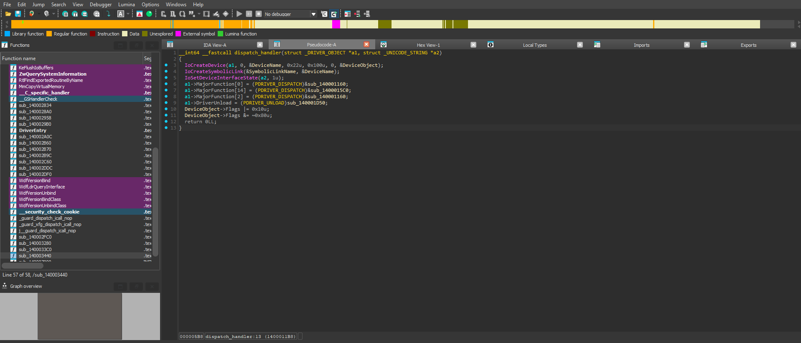
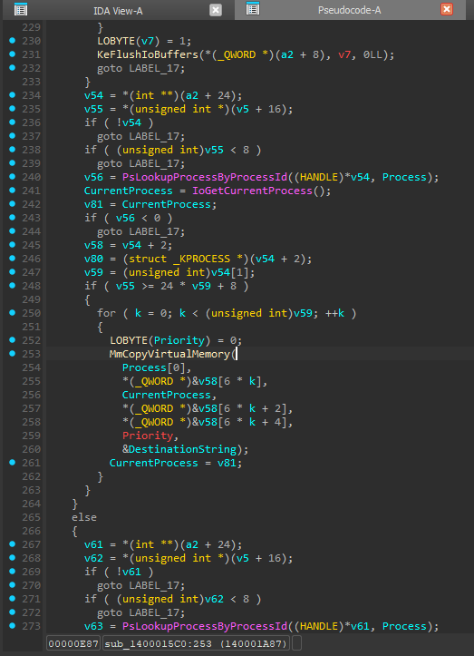
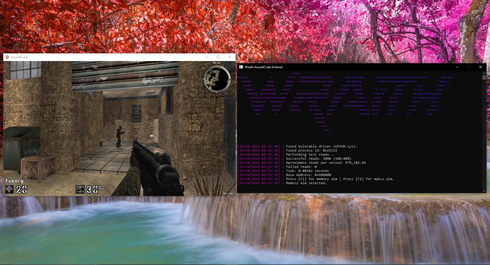

# Wraith-External

This project abuses the signed vulnerable driver **KKYUM.sys** to call IOCTL virtual memory read/write functions at the operating system's highest privilege level, the kernel (ring 0) via the undocumented kernel function **MmCopyVirtualMemory**.
**KKYUM.sys** has absolutely no process, handle, or signature verification, meaning any process, regardless of its privilege level, can open a handle to its device object and freely call its IOCTL functions.

`KKYUM.sys` exposes two undocumented IOCTL codes recovered through static reverse engineering in IDA Pro:

| Operation | IOCTL Code |
|-----------|------------|
| Virtual memory read | `0x22265C` |
| Virtual memory write | `0x222658` |

---

## What is BYOVD?

BYOVD (Bring your own vulnerable driver) is an attack technique where an attacker loads a legitimately signed however vulnerable kernel driver onto a target system and uses it to execute code in a higher execution level then normally allowed, in this case ring 0 without needing to create or sign their own driver. The key vulnerability is that DSE (Driver Signature Enforcement) only checks if a driver is signed by Microsoft or a trusted Third party with a trusted certificate, if a driver meets this criteria, Windows will gladly load this driver without thinking otherwise. BYOVD is more common than you think, popular applications such as hardware monitoring tools, such as MSI Afterburner and SignalRgb are known BYOVD's. `KKYUM.sys` is a clear example of this, leaking kernel memory read/write functions via `DeviceIoControl` with zero caller validation.

---

## IDA Pro Reverse Engineering

`KKYUM.sys` was loaded into IDA Pro for static analysis. The primary goal was to locate the driver's IRP_MJ_DEVICE_CONTROL dispatch routine and extract the IOCTL codes it handles.

<details>
<summary>Methodology</summary>
<br>

1. Opened `KKYUM.sys` in IDA Pro and waited for auto-analysis to complete.
2. Located `DriverEntry` and traced the assignment of the `MajorFunction` dispatch table to find the `IRP_MJ_DEVICE_CONTROL` handler.
3. Inside the handler, identified the switch statement (or equivalent if/else chain) that dispatches on the IOCTL code extracted from the IRP's `Parameters.DeviceIoControl.IoControlCode`.
4. Recovered two control codes:

| Operation | IOCTL Code |
|-----------|------------|
| Virtual memory read | `0x22265C` |
| Virtual memory write | `0x222658` |

Analysed the input buffer structure expected by each handler. Both operations expect a `MemoryRequest` structure beginning with a 32-bit process ID, and a 32-bit operation count, followed by a variable-length array of `MemoryOperation` records, each holding a 64-bit source address, 64-bit destination address, and 64-bit byte count. No authentication, privilege check, or handle validation was found in either handler paths, confirming the driver accepts requests from any caller that can open a handle to its device object.

</details>

<details>
<summary>Screenshots</summary>
<br>




</details>

---

## Memory Read/Write Implementation

The structures recovered from IDA Pro were replicated in C++ to build a user-mode wrapper to the driver.

Device handle: A handle to the driver's device object is obtained at initialization via `CreateFile` and stored in `mem::g_device`. All driver-related calls go through this handle.

<details>
<summary>mem::read&lt;T&gt;</summary>
<br>

`mem::read<T>(address)` templated wrapper the value type. Fills a `MemoryRequest` with the target process ID and a single `MemoryOperation` whose source is the remote address and destination is the address of a local stack variable. Sends the request via `DeviceIoControl` with IOCTL `0x22265C`. The driver copies `sizeof(T)` bytes from the target process into the local variable, which is then returned. A `static_assert` guards against types with non-standard copy layouts.

```cpp
template <typename T>
T read(std::uintptr_t address)
{
    static_assert(std::is_trivially_copyable_v<T>);

    T value{};

    MemoryRequest request{};
    request.pid = g_pid;
    request.operationCount = 1;
    request.operations[0].source = address;
    request.operations[0].destination = reinterpret_cast<std::uint64_t>(&value);
    request.operations[0].size = sizeof(T);
    DWORD bytes_returned = 0;

    if (!DeviceIoControl(g_device, ioctl_codes::mem_read, &request, sizeof(request), nullptr, 0, &bytes_returned, nullptr))
    {
        std::println("Failed read at {:#x}, error {}", address, GetLastError());
        return T{};
    }

    return value;
}
```

</details>

<details>
<summary>mem::write&lt;T&gt;</summary>
<br>

`mem::write<T>(address, value)` uses the same structure, using IOCTL `0x222658`. The source and destination semantics are reversed: source is the remote address to write to and destination is the local buffer to read from.

```cpp
template <typename T>
bool write(std::uintptr_t addr, T value)
{
    MemoryRequest request{};
    request.pid = mem::g_pid;
    request.operationCount = 1;
    request.operations[0].source = addr;
    request.operations[0].destination = reinterpret_cast<std::uint64_t>(&value);
    request.operations[0].size = sizeof(T);
    DWORD bytes_returned = 0;

    return DeviceIoControl(mem::g_device, ioctl_codes::mem_write, &request, sizeof(request), nullptr, 0, &bytes_returned, nullptr);
}
```

</details>

<details>
<summary>mem::GetPid</summary>
<br>

`mem::GetPid(process_name)` is a non-driver related function that walks the process snapshot via `CreateToolhelp32Snapshot` / `Process32FirstW` to retrieve a process name to a process ID, which is stored in `mem::g_pid` before any read or write is attempted.

```cpp
std::uint32_t GetPid(const std::wstring& process_name) {
    std::uint32_t pid = 0;

    void* hSnapshot = CreateToolhelp32Snapshot(TH32CS_SNAPPROCESS, 0);
    if (hSnapshot == INVALID_HANDLE_VALUE) {
        return 0;
    }

    PROCESSENTRY32W pe32;
    pe32.dwSize = sizeof(PROCESSENTRY32W);

    if (Process32FirstW(hSnapshot, &pe32)) {
        do {
            if (process_name == pe32.szExeFile) {
                pid = pe32.th32ProcessID;
                break;
            }
        } while (Process32NextW(hSnapshot, &pe32));
    }

    CloseHandle(hSnapshot);
    return pid;
}
```

</details>

---

## Why AssaultCube?

You may be thinking why make a cheat for such an old game, and that is a valid question to ask. The answer is because `KKYUM.sys` doesn't have a "get base address" function. This makes Assault Cube a primary target because it isn't built with ASLR enabled, essentially meaning that its image base address doesn't change, making it constant across instances, meaning I can hard code it, I am aware that this is bad practise, however there isn't really a better way without opening a handle to the game, defeating this projects purpose entirely.

---

## How to build & run

1. Open the project in Visual Studio and build under `x64 -Release`.
2. Open an administrator command prompt and run:
```
sc create KKYUM type= kernel binpath= "path to driver"
sc start KKYUM
```
3. After you have confirmed the driver has been created and is running, open Assault Cube and run the executable. If you don't have a Makcu device you will have to use memory aim.
4. If you wish to unload the driver, run:
```
sc stop KKYUM
```

> **Note:** The default aimbot key is right click, you can change this in the source code if you wish. Makcu aim has support for stock and Medius firmware. The medius_capi.dll file must be in the executables directory or the cheat will refuse to launch.

---


